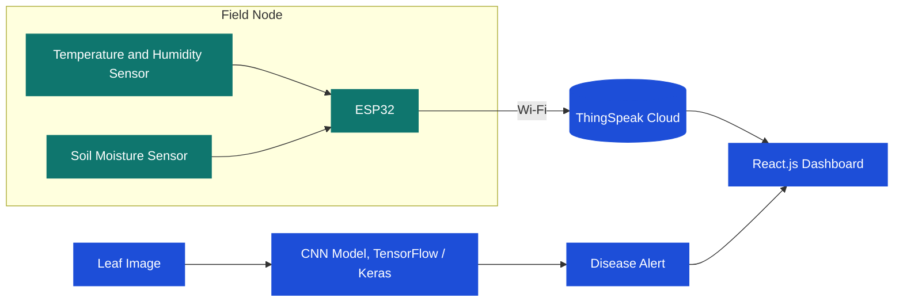
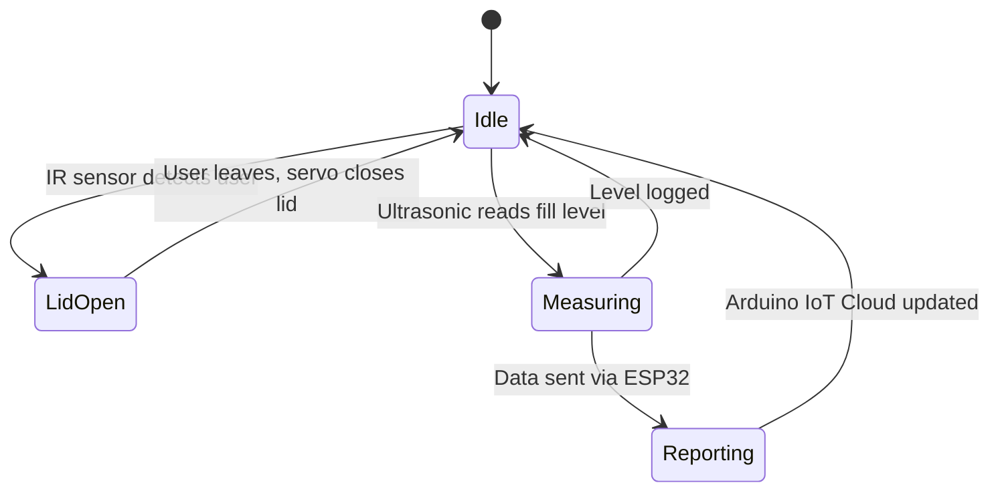
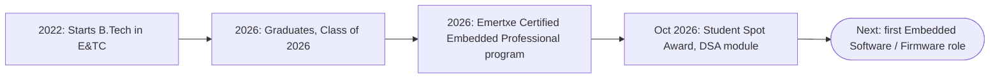

<div align="center">

# `SANJAY_HIBARE.elf`

**Embedded Software & Firmware Developer, v2026.1**

*"If it can blink an LED, it can change the world."*


[Boot Log](#-boot-log) · [Datasheet](#-datasheet) · [Skills](#️-skill-memory-map) · [Architecture](#-how-my-iot-projects-work) · [Projects](#-firmware-releases-projects) · [Roadmap](#-roadmap) · [Contact](#-communication-interfaces)

</div>

---

## 🔌 Boot Log

```text
[  OK  ] Loaded degree ............ B.Tech, Electronics & Telecommunication (2026)
[  OK  ] Mounted training ......... Emertxe Certified Embedded Professional
[  OK  ] Initialised language ..... C  (primary), C++
[  OK  ] Detected peripherals ..... UART, SPI, I2C
[  OK  ] Awards ................... Student Spot Award, Emertxe (DSA module)
[  ..  ] Starting service ......... Linux Internals
[  ..  ] Starting service ......... Firmware Development
[ WAIT ] Waiting for .............. first embedded role  <-- you can help here :)
```

---

## 📄 Datasheet

| Parameter | Value |
|-----------|-------|
| **Device** | Sanjay Hibare |
| **Package** | B.Tech Graduate, Electronics & Telecommunication, Class of 2026 |
| **Core** | C Programming, Data Structures, Problem Solving |
| **Clock source** | Curiosity (external crystal: coffee) |
| **Interfaces** | UART, SPI, I²C, GPIO, Timers, Interrupts |
| **Operating mode** | Learn, build, debug, repeat |
| **Application** | Embedded Software, Firmware, Hardware-Software Integration |
| **Availability** | Entry-level roles, open now |

---

## 🗺️ Skill Memory Map

| Address range | Region | Contents |
|---------------|--------|----------|
| `0x0000` – `0x0FFF` | **Language Core** | C, C++, Pointers, Structures, Dynamic Memory, Bitwise Operations |
| `0x1000` – `0x1FFF` | **Data Structures** | Linked Lists, Hashing, File Handling, String Handling |
| `0x2000` – `0x2FFF` | **Peripherals** | GPIO, Analog I/O, Character LCD, Timers, Counters, Interrupts |
| `0x3000` – `0x3FFF` | **Protocols** | UART, SPI, I²C |
| `0x4000` – `0x4FFF` | **Boards and IoT** | ESP32, Arduino Mega, Ultrasonic and IR sensors, Servo, ThingSpeak |
| `0x5000` – `0x5FFF` | **Toolchain** | GCC, GDB, Makefile, Linux CLI, Git, VS Code, Arduino IDE, Proteus, Keil µVision |
| `0x6000` – `0x6FFF` | **Scripting and extras** | Shell Scripting, Python, TensorFlow/Keras, React.js (academic projects) |

---

## 🧠 How My IoT Projects Work

### System block diagram: Smart Crop Monitoring and Disease Detection



### State machine: IoT Smart Waste Management



<sub>These diagrams show the overall flow of each project. Adjust the labels if your implementation differs.</sub>

---

## 📦 Firmware Releases (Projects)

Click a project to expand its details.

<details>
<summary><b>v1.0 · Inverted Search</b> · <code>C</code> <code>Hashing</code> <code>Linked Lists</code></summary>

<br/>

**What it does:** builds an index of words from multiple text files and finds which files contain a given word, using hashing and linked lists to store and retrieve the data efficiently.

**Tech:** Advanced C, Data Structures, Hashing, Linked Lists, File Handling, Pointers

**Key learnings**
- Implemented a hash table with linked lists to store and manage word indexes.
- Worked with multiple files and file pointers to read, process and search contents.
- Strengthened hashing, linked-list operations, pointers and modular C programming.

</details>

<details>
<summary><b>v1.1 · Arbitrary Precision Calculator</b> · <code>C</code> <code>Linked Lists</code> <code>Dynamic Memory</code></summary>

<br/>

**What it does:** performs arithmetic on very large numbers beyond the range of standard integer types, representing each number as a linked list.

**Tech:** Advanced C, Data Structures, Linked Lists, Pointers, Dynamic Memory Allocation

**Key learnings**
- Represented large numbers with linked-list nodes instead of standard integer types.
- Implemented arithmetic using pointers, dynamic memory allocation and list traversal.
- Strengthened self-referential structures, dynamic memory management and modular programming.

</details>

<details>
<summary><b>v1.2 · MP3 Tag Reader</b> · <code>C</code> <code>Binary File I/O</code></summary>

<br/>

**What it does:** a command-line tool that reads and displays MP3 metadata such as title, artist and album.

**Tech:** Advanced C, File Handling, File Pointers, String Operations, MP3 Metadata

**Key learnings**
- Worked with binary file handling to access and process MP3 metadata.
- Implemented parsing and string operations to extract and display tag information.
- Strengthened file I/O, structures, pointers and command-line argument handling.

</details>

<details>
<summary><b>v1.3 · Image Steganography</b> · <code>C</code> <code>Bitwise Operations</code></summary>

<br/>

**What it does:** encodes secret data into an image file and decodes the hidden data when required.

**Tech:** Advanced C, File Handling, Bitwise Operations, Data Encoding, Pointers

**Key learnings**
- Implemented encoding and decoding logic to hide and retrieve data from images.
- Applied bit-level manipulation during the encoding process.
- Strengthened binary file handling, pointers and data representation.

</details>

<details>
<summary><b>v1.4 · Address Book</b> · <code>C</code> <code>Structures</code> <code>File Handling</code></summary>

<br/>

**What it does:** a contact manager to create, search, update, delete and display contacts, with data saved to a file for future use.

**Tech:** Advanced C, Structures, File Handling, Functions, Pointers

**Key learnings**
- Used structures and functions to organise contact information.
- Implemented search, update, delete and display operations.
- Stored and retrieved data with file handling and strengthened modular C skills.

</details>

<details>
<summary><b>v2.0 · Smart Crop Monitoring and Disease Detection</b> · <code>ESP32</code> <code>CNN</code> <code>IoT</code></summary>

<br/>

**What it does:** monitors temperature, humidity and soil moisture with an ESP32, shows the data on a web dashboard, and detects plant diseases from leaf images with a CNN model.

**Tech:** ESP32, Arduino IDE, Python, TensorFlow/Keras, CNN, React.js, ThingSpeak, Sensors

**Key learnings**
- Integrated multiple sensors with ESP32 for real-time monitoring.
- Worked with CNN-based image classification for disease detection.
- Combined embedded sensing, IoT monitoring, web visualisation and machine learning in one system.

</details>

<details>
<summary><b>v2.1 · IoT Smart Waste Management</b> · <code>Arduino Mega</code> <code>ESP32</code> <code>Sensors</code></summary>

<br/>

**What it does:** monitors dustbin fill level with an ultrasonic sensor, detects users with an IR sensor, and opens the lid automatically with a servo motor, with ESP32-based IoT monitoring.

**Tech:** Arduino Mega, ESP32, Embedded C, Arduino IoT Cloud, Ultrasonic Sensor, IR Sensor, Servo Motor

**Key learnings**
- Interfaced ultrasonic and IR sensors with the microcontroller for automated operation.
- Implemented servo motor control for the automatic lid.
- Strengthened Embedded C, sensor interfacing and IoT-based monitoring.

</details>

<sub>Add a repository link to each project title, for example `[Inverted Search](https://github.com/S4NJA9/REPO_NAME)`, then delete this line.</sub>

---

## 🧭 Roadmap


🟩 Strong foundation  ·  🟧 Learning now  ·  🟪 Goal

### Journey



---

## ⚡ Interrupt Vector Table (what has my attention right now)

| Priority | Interrupt | Status |
|:--------:|-----------|--------|
| 0 | `IRQ_LINUX_INTERNALS` | Handling now |
| 1 | `IRQ_EMBEDDED_C` | Handling now |
| 2 | `IRQ_FIRMWARE_DEV` | Pending |
| 3 | `IRQ_DSA_PRACTICE` | Running daily on LeetCode |

---

## 🎯 What I'm Looking For

- An **entry-level Embedded Software / Firmware** role where I can learn from real production code.
- A team that values **clean C, careful debugging and hardware-software integration**.
- Opportunities to grow into **Linux internals, drivers and protocol-level work**.

---

## 🧩 Main Loop

```c
#include <stdio.h>

int main(void)
{
    while (1) {
        learn();
        build();
        debug();      /* the longest step, and where the real learning happens */
        improve();
        printf("commit and push\n");
    }
    return 0;
}
```

---

## 📡 Communication Interfaces

| Interface | Link |
|-----------|------|
| **I²C: Email** | [sanjayhibare2004@gmail.com](mailto:sanjayhibare2004@gmail.com) |
| **SPI: LeetCode** | [Sanjay_leetcode4999](https://leetcode.com/u/Sanjay_leetcode4999/) |
| **UART: GitHub** | [S4NJA9](https://github.com/S4NJA9) |

<div align="center">

[](mailto:sanjayhibare2004@gmail.com)
[](https://leetcode.com/u/Sanjay_leetcode4999/)
[](https://github.com/S4NJA9)

<br/>

*Open to entry-level Embedded Software, Firmware and Embedded Systems roles.*

</div>
